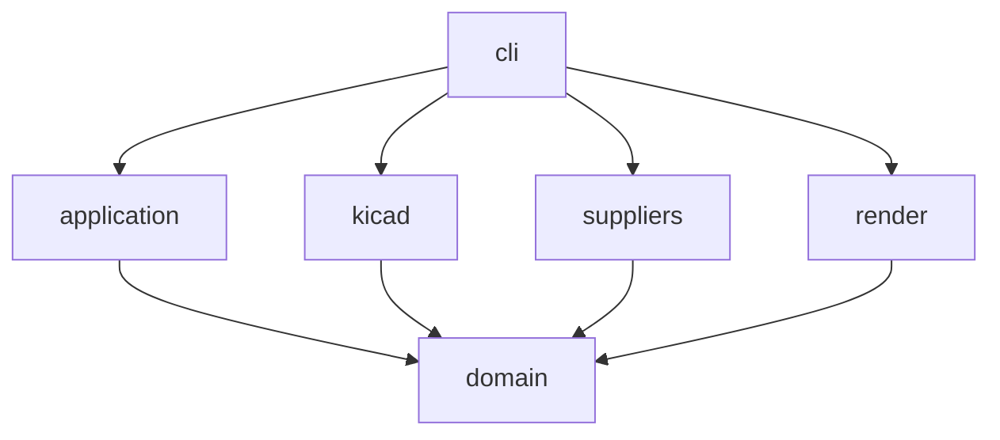

# pcbcraft

One Rust program in this repository. KiCad 10 is invoked only through `kicad-cli`. Schematic, board, and project files are never written. `KICAD_CLI` overrides the binary path. Every user-facing string is English: help, errors, the CPL report, and the net dump. Comments inside the moved CPL algorithm may stay Polish.

The longfred-hardware repository stays unchanged. `export-sbom.sh` keeps calling the existing `jlc-cpl`.

`make` builds the workspace (`cargo build --workspace`). `make test` runs `cargo test --workspace --lib --bins`. A short overview for people lives in `README.md`.



Adapters that implement application ports also depend on the application crate. They do not depend on each other.

## Layers

Workspace in `Cargo.toml`. Each crate is `edition = "2021"`, `forbid(unsafe_code)`, `publish = false`. Dependencies point toward the domain. `application` does not depend on `kicad`, `suppliers`, or `render`.

The domain holds nouns and rules. It parses the parts YAML and the CPL correction CSV, because those documents are its language. It does not spawn processes, call HTTP, or draw PDF. A `PathBuf` on `Project` is data. Checking that a file exists is the adapter's job.

Use cases depend on ports:

- `Fabrication` — BOM, positions, Gerbers, outline, drills, side SVG, netlist, ERC, DRC. Returns domain types.
- `RotationDb` — text of the CPL correction database.
- `DrawingRenderer` — places a `Page` or an SVG onto PDF.
- `TestPrinter` — suite header, test line, separator, summary. A line is `{group}: {name}`, or `{group}.{name}` when the line is a subtest. The colored implementation is in `cli` and flushes after every line.
- `NetGraphSource` — pin-to-pin graph. The adapter owns the cache and returns structs.
- `ComponentStore` — read and write `.pcbcraft/components.sqlite3`. Part cards come from `SupplierCatalog`, not from HTTP inside the store.
- `UsedParts` — LCSC and PCBWay numbers taken from the schematic.
- `PartStock` — stock for one catalog id. The CLI implements it with `SupplierCatalog::fetch`. `Ok(None)` means the catalog returned no quantity.

`ERCValidator` and `DRCValidator` live in `application` and call `Fabrication`. They do not know KiCad's JSON. `LcscCatalog` and `PcbwayCatalog` live in `suppliers` and implement `SupplierCatalog` from the domain. Alternative search and the component database call that same trait.

The moved CPL module keeps `anyhow`, so the tests from `jlc-cpl` pass without a rewrite. New layers use `thiserror`. An adapter turns a process or HTTP failure into a port error, and the use case forwards it.

```text
crates/domain/src/
  project.rs
  cpl/          correct, db, local, placement, table
  drawing/      side, page, geometry
  validate/     report, test_file
  parts/        supplier, offer, lcsc, pcbway, units, search
  net/          component, pin, connection, graph
crates/application/src/
  ports/        fabrication, rotation_db, drawing_renderer, test_printer, net_graph, supply
  export/       bom, pos, cpl, gerbers, drawing
  validate/     scheduler, erc, drc, availability, init
  parts/        alternatives, sync
  net/          dump
crates/kicad/src/
  command.rs    kicad-cli, KICAD_CLI, stderr
  project.rs    name.kicad_pro and sibling sch/pcb
  bom.rs pos.rs gerbers.rs
  dxf.rs excellon.rs svg.rs
  netlist.rs erc.rs drc.rs
  rotation_db.rs
  net/          sexp, schematic, board, build, cache, load
  used_parts.rs
  components_db.rs
crates/suppliers/src/
  catalog.rs http.rs lcsc.rs pcbway.rs
crates/render/src/
  pdf.rs svg_page.rs
crates/cli/src/
  main.rs args.rs printer.rs net_dump.rs
```

`clap` is only in `cli`. `ureq` is in `suppliers` and in `kicad` when downloading the correction database. `serde_json`, `quick-xml`, and `zip` are in `kicad`. Bundled `rusqlite` is in `kicad` for `net.sqlite` and `components.sqlite3`. `printpdf` is in `render`. The domain uses `serde`, `serde_yaml`, `serde_json`, `csv`, and `fancy-regex`. JSON Schema checking sits next to `ValidationScheduler` in `application` (`jsonschema`). ANSI codes are only in `cli/printer.rs`.

The binary name stays `pcbcraft`. From `name.kicad_pro` the adapter takes the sibling `name.kicad_sch` and `name.kicad_pcb`. A missing file is an error. `--schematic` and `--board` select a different pair. The correction database URL stays `CORRECTIONS_URL`. Its cache is `$XDG_CACHE_HOME/pcbcraft`. The LCSC client is `crates/suppliers/src/lcsc.rs`. The PCBWay client is `crates/suppliers/src/pcbway.rs`.

`-o` is optional. Without it the file lands in the current directory: `<name>-bom.csv`, `<name>-pos.csv`, `<name>-cpl.csv`, `<name>-gerbers.zip`, `<name>-drawing.pdf`. `-` is stdout where the result is text.

## BOM, position, CPL, and Gerber export

The pattern is `longfred-hardware/tools/export-sbom.sh` and `gerbers.sh`.

`pcbcraft export bom <schematic|project>` runs:

```text
kicad-cli sch export bom --exclude-dnp
  --fields "Reference,Value,Footprint,LCSC Part #"
  --labels "Designator,Comment,Footprint,LCSC Part #"
  --group-by "Footprint,LCSC Part #"
  --ref-delimiter "," --ref-range-delimiter ""
```

Then, as in the Python step: when `Comment` contains a comma, the cell becomes the footprint name after the last `:`. The rewrite quotes every field.

`pcbcraft export pos <board|project>` runs `kicad-cli pcb export pos --format csv --units mm --side both --exclude-dnp`. That is the raw KiCad file, with no angle correction.

`pcbcraft export cpl` on a project or board first writes that BOM and that position file in a temporary directory, then corrects them. A position CSV skips the KiCad export and takes `--bom`, as `jlc-cpl fix` does. Engine flags stay: `--local`, `--db`, `--corrections`, `--update`, `--cache-dir`, `--dry-run`, `--quiet`. A second run on an already corrected file mirrors the bottom again. The help text keeps that warning.

The order file has the five columns from `export-sbom.sh`: `Designator,Mid X,Mid Y,Layer,Rotation`. Designators that are `FP` plus digits are dropped. `top` / `bottom` become `Top` / `Bottom`. An empty position file yields the header only. Angle math, bottom mirroring, offset, and the stderr report are those of `jlc-cpl`.

`pcbcraft export gerbers <board|project> -o board.zip` runs `kicad-cli pcb export gerbers --board-plot-params --check-zones` and `kicad-cli pcb export drill --excellon-separate-th`, then zips the files (deflate, names without directories, alphabetical order).

## 2D drawing

`pcbcraft export drawing <board>` builds a landscape A4 page, 297 mm by 210 mm, at scale 1. The page margin is 10 mm. When the drawing does not fit, the command errors with the board size and writes nothing.

`--side` accepts `side` or `back`. `side` is the front (`F.*` in KiCad). `back` is the bottom (`B.*`), mirrored so it reads from the bottom side. Without `--side`, both faces share one page: `side` on top, `back` below, with a gap. Each view is centered in its own band, the upper and lower half of the page. Both views use scale 1. When either view does not fit its band, the command errors with the dimensions.

A drawing without `--full` is black and white: outline and drills. `back` gets the same outline and the same holes after a horizontal mirror.

- Outline: `kicad-cli pcb export dxf --layers Edge.Cuts --output-units mm --use-drill-origin --exclude-refdes --exclude-value`.
- Holes: `kicad-cli pcb export drill --format excellon --excellon-units mm --drill-origin plot --excellon-zeros-format decimal`.
- The shared origin is the drill origin. The parser reads DXF lines, polylines, arcs, and circles, and Excellon hits (`T01C0.300`, decimal coordinates) and `G85` slots. An unknown drill record aborts the command.
- `printpdf` draws a black outline and circles of the tool diameter. One side fills the page. Both sides place the same figures in the upper and lower bands, and the bottom is mirrored.

`--full` is independent of `--side` and turns color on. `pcbcraft export drawing --side side --full` draws only the front. `pcbcraft export drawing --side back --full` draws only the bottom. `pcbcraft export drawing --full` places the colored front on top and the colored bottom below.

`side` layers: `F.Cu,F.Mask,F.SilkS,F.Paste,Edge.Cuts`. `back` layers: `B.Cu,B.Mask,B.SilkS,B.Paste,Edge.Cuts` plus `--mirror`. Export goes through `kicad-cli pcb export svg --page-size-mode 2 --exclude-drawing-sheet --scale 1 --drill-shape-opt 2`. The color theme stays the PCB editor default. The SVG is placed 1:1 in its band or on the full page, the same way as the black-and-white drawing.

Check on `longfred-v1a.kicad_pcb`: `pdfinfo` reports an A4 MediaBox. A drawing without `--side` has two bands. `--side side` and `--side back` have one view each. The circle count of one view equals the Excellon hit count. A `--full` PDF is non-empty.

## Project tests

`pcbcraft tests run` reads `*.json` from `tests/pcbcraft` relative to the current directory. `pcbcraft tests run <directory>` selects another directory. `pcbcraft tests run --name erc-test` runs that one file, including its subtests. The name is the path of the file relative to the test directory, without `.json`. `pcbcraft tests list` prints those tests and then the known types. One file is one test. The test name is the path relative to that directory, without `.json`. Files are collected recursively and sorted by that path.

```json
{
  "type": "ERCValidator",
  "spec": {
    "project": "../../longfred-v1a/longfred-v1a.kicad_pro"
  }
}
```

`type` selects the validator. Only that validator reads `spec`. Paths inside `spec` are relative to the JSON file. Each validator publishes a JSON Schema for its `spec`. Extra fields are rejected (`additionalProperties: false`). `ERCValidator` and `DRCValidator` require `project` and nothing else.

`pcbcraft tests init defaults` creates the test directory when it is missing and writes `erc-test.json`, `drc-test.json`, and `availability-test.json`. A file that already exists is left untouched. It exits 0 and does not run the suite. `pcbcraft tests init` itself only groups `defaults` and `type`. `pcbcraft tests init type ERCValidator my-erc` writes `my-erc.json`. The type and the file name, without an extension, are both required. Omitting them prints an error and the known types. When the current directory contains exactly one `.kicad_pro`, `spec.project` is a path to that file relative to the test directory. Otherwise the scaffold uses `project.kicad_pro` and the command prints `Set spec.project in those files to your .kicad_pro.` The availability scaffold sets `defaultMinimum` to 10 and `part` to an empty object. When every default file is already present, the command prints that the directory already has the default tests.

`ValidationScheduler` in `crates/application/src/validate/scheduler.rs` runs three steps. It prints through `TestPrinter` as each check finishes. It does not collect the run and print it at the end.

1. Check every file's schema. An unknown `type`, broken JSON, or a `spec` outside the schema is collected into one list. Any scheduler error means no validator runs. Those errors are printed before any group, and the run stops.
2. Build the run list: the `ERCValidator` group, then the `DRCValidator` group, then the `PartAvailability` group, and path order inside a group.
3. Run one group at a time. Print the suite header when the group starts. The count is the number of lines that group will print. Then print each line as soon as that check returns, and flush it. A dim dashed line is printed before the next group header. The summary is printed after the last line.

ERC and DRC know their line count from the file list, so the header is printed before `kicad-cli` runs. `PartAvailability` walks the schematic first, with no HTTP, so the header count includes every part line. Each stock lookup then prints its own line before the next lookup starts. The time on an ERC or DRC line is that file's run. The time on a part line is that part's stock lookup.

`Report` is shared by ERC and DRC. `Symbol` has reference, value, footprint, library id (`Device:R`), and properties, including `LCSC Part #`. `Net` has a name and pins of reference plus pin number. `Violation` has `check` (`erc` or `drc`), severity (`error`, `warning`, `exclusion`), kind, description, and items with description, uuid, and position in millimetres. `Report` and `Design` live in `crates/domain`. The `kicad` adapter parses the XML netlist and returns `Design`.

- `ERCValidator` takes violations from `Fabrication`. The adapter runs `kicad-cli sch erc --format json --severity-all --units mm` and parses JSON into `Violation`. It does not pass `--exit-code-violations`, so JSON is produced even when violations exist, and it does not save the schematic.
- `DRCValidator` takes its result from the port the same way. The adapter runs `kicad-cli pcb drc --format json --severity-all --units mm --refill-zones`. It does not pass `--save-board`, so the board file stays untouched.

An ERC or DRC test passes when the report has no `error` severity violation. A warning stays in the report and does not fail the test. One such test counts as one assertion, plus one assertion per violation. An `error` violation is a failed assertion.

`PartAvailability` checks the stock of every LCSC or PCBWay number used on the schematic. Numbers come from `UsedParts`, which walks the sheets and reads the same field aliases as the net graph. The same supplier and number are checked once. Stock comes from `PartStock`, which calls `SupplierCatalog::fetch` for that supplier. The schema requires `project`. `defaultMinimum` is an optional integer of at least 0 and defaults to 100 when the field is absent. `part` is an optional object whose values are integers of at least 0. The key is the catalog number, without a supplier prefix. A number listed in `part` uses that floor. Every other number uses `defaultMinimum`. The old key `minimum` is rejected.

```json
{
  "type": "PartAvailability",
  "spec": {
    "project": "../../longfred-v1a/longfred-v1a.kicad_pro",
    "defaultMinimum": 100,
    "part": {
      "C12345": 20
    }
  }
}
```

Each part is its own subtest, printed as `PartAvailability.C12345`. The line fails when stock is below the floor, when the catalog returns no quantity, or when the lookup returns an error. A schematic with no LCSC or PCBWay numbers is one ordinary line, not a subtest, and it fails with `no LCSC or PCBWay part numbers on the schematic`. When the same number is used at both suppliers, the lines are `PartAvailability.lcsc:C1` and `PartAvailability.pcbway:C1`. Each part line is one assertion.

The printer in `crates/cli/src/printer.rs` implements `TestPrinter`. The layout matches the PHPUnit screenshot:

- a white group header with a count, for example `ERCValidator (2)` or `PartAvailability (12)`
- a line `✓ ERCValidator: erc-test (0.29s)`: green check, group in magenta, `: ` and the test name in white, time in gray
- a subtest line `✓ PartAvailability.C12345 (0.12s)`: the group in magenta is followed immediately by `.` and the part number in white
- a dim dashed line between groups
- `Time: 904 ms, Memory: 24.00MB` underneath
- a green `OK (N tests, M assertions)` at the end

`Time` is the whole run. `Memory` is `VmHWM` from `/proc/self/status`. A failed line has a red `✗` and the detail lines underneath. The printer then writes a red `FAILURES!` with the same counters. The suite header count is the number of printed lines in that group, including subtests. Colors go to a terminal. A pipe gets the same layout without ANSI, and each line is flushed so the run is visible while it is still going.

Exit code 0 when every test passed. Exit code 1 when a test failed. Exit code 2 when schemas blocked the run, the directory is missing, or the directory has no JSON file. `pcbcraft.yaml` can skip lines; see `004-skipped-tests.md`.

`Attributes` checks mounting holes and fiducials. It is described in `005-attributes.md`. `CatalogValue`, `ResistorPower`, `VoltageRating`, `Divider`, `TimeConstant`, `ParallelPassives`, and `SeriesPassives` are separate test types. They are described in `002-electrical-tests.md` and are not written by `pcbcraft tests init defaults`. `pcbcraft tests init type` writes them.

## Supplier alternatives

`pcbcraft parts alternatives spec.yaml` reads only YAML. It does not open the KiCad project. Each item has `name`, a required `supplier` (`lcsc` or `pcbway`), and `parameters`. There are no shared search keys beyond those three fields.

The parser reads `supplier` first, then deserializes `parameters` into that supplier's struct with `deny_unknown_fields`. An LCSC key on a `pcbway` item, and a PCBWay key on an `lcsc` item, is a syntax error that names the supplier. A missing `supplier` is an error too. One supplier's implementation never receives the other supplier's parameters.

```rust
pub trait SupplierCatalog {
    type Query;
    fn supplier(&self) -> Supplier;
    fn fetch(&self, part_ids: &[String]) -> Result<Vec<PartRecord>>;
    fn search(&self, query: &Self::Query) -> Result<Vec<PartRecord>>;
}
```

`LcscCatalog` and `PcbwayCatalog` are the only implementations. `fetch` loads part cards by id. `search` looks for alternatives. Both return `PartRecord`: supplier, id, MPN, manufacturer, package, category, description, stock, price, and the parameter list. The dispatcher picks the implementation from `supplier` and does not translate a query across catalogs. `crates/suppliers` has no second HTTP path beside these two types.

```yaml
items:
  - name: R12
    supplier: lcsc
    parameters:
      category: resistor
      package: "0805"
      resistance: { min: "9.9k", max: "10.1k" }
      tolerance: { min: "0.1%", max: "1%" }
      power: { min: "0.0625W", max: "0.25W" }
      dielectric: ["X7R", "X5R"]
  - name: U1
    supplier: pcbway
    parameters:
      mpn: ["STM32F103C8T6"]
      manufacturer: ["STMicroelectronics", "ST"]
      package: ["LQFP-48"]
      description: ["Cortex-M3"]
```

LCSC parameters stay parametric. Every electrical parameter is either a `min`/`max` range (both ends required) or a list of values. A bare number and a one-sided bound are syntax errors. `category` and `package` sit inside `parameters`. Units reduce to SI: `10k`, `10 kΩ`, `100nF`, `1%`, `±1%`, `1/16W`, `16V`. Comparison is numeric and inclusive. A list matches after case folding. A candidate missing the attribute is excluded.

`LcscCatalog` calls the same unofficial API as the JLCPCB plugin: `POST https://jlcpcb.com/api/overseas-pcb-order/v1/shoppingCart/smtGood/selectSmtComponentList/v2`, with the package in `componentSpecificationList`. The keyword is category, package, and the midpoint of the main value range. The range and list filter lives in the domain and decides whether a part is an alternative. Results are paged, 10 hits per item by default. In-stock parts remain by default. `--include-out-of-stock` and `--basic` apply only to `lcsc` items. Order is basic library first, then higher stock.

PCBWay parameters are lists of accepted values and describe what PCBWay asks for in an assembly BOM: `mpn` (required, at least one number), and optionally `manufacturer`, `package`, and `description`. Resistance, tolerance, or voltage ranges are unknown keys and fail parsing. A range on `mpn` also fails, because `mpn` is a list of strings.

`PcbwayCatalog` does not call the LCSC catalog and does not invent a fallback search. The public Partner API (`https://api-partner.pcbway.com/Help`) quotes PCB and SMT and places orders. It has no part search. `fetch` and `search` both fail with `PCBWay catalog cannot be queried: the public partner API has no part search ({mpn})`. The YAML schema, rejection of foreign keys, and parser tests stay in the domain.

Text output is one table with a supplier column. `--format yaml` groups hits under the item and keeps `supplier` plus that catalog's attributes.

## Project component database

`pcbcraft components sync` builds `.pcbcraft/components.sqlite3` next to the `.kicad_pro` file. Part numbers come from the schematic parser: the LCSC field, using the same aliases as the net graph, and the PCBWay field from `PCBWay`, `PCBWay Part #`, or `PCBWay Part Number`. A component with both fields yields two numbers. Sync groups numbers by supplier and calls `SupplierCatalog::fetch`.

The database has three tables. `parts` holds the card: supplier, number, MPN, manufacturer, package, category, description, stock, price, and fetch time. `parameters` holds every electrical parameter returned by the API, under the catalog's name, with the text value and an SI number when it can be read. For LCSC those are the attributes the website filters on, such as resistance, tolerance, voltage, power, capacitance, and dielectric. `usage` links a schematic reference to a number. Each sync rebuilds `usage` from the current schematic and deletes `parts` rows that nothing uses anymore. A number already in `parts` is not fetched again. `pcbcraft components sync --refresh` fetches every number again.

`PcbwayCatalog::fetch` uses the same implementation as search, so a PCBWay number fails sync with the catalog error above. When a fetch succeeds and returns no electrical parameters, the `parts` row is still written and `parameters` stays empty for that number.

## Net parser

The parser builds a connection graph from the schematic and pcbnew files. The structs live in `crates/domain/src/net/`. A net name is not a key: the same name can describe many connections and several disconnected groups.

```rust
struct Component {
    reference: String,
    symbol: String,
    value: String,
    footprint: String,
    description: String,
    lcsc: Option<String>,
    pcbway: Option<String>,
}

struct Pin {
    reference: String,
    number: String,
    name: String,
}

struct Connection {
    name: String,
    from: Pin,
    to: Pin,
}

struct CopperNet {
    name: String,
    track_widths_mm: Vec<f64>,
    connections: Vec<Connection>,
}
```

Each connection is a pin pair. Pins of one electrical KiCad net form a star: the pin with the smallest reference and number is the hub, and the others connect to it. The star is a tree, and every arm shares the name. Two nets with the same text, disconnected on different sheets, stay two stars.

A component comes from a schematic symbol. `symbol` is the `lib_id`, for example `Device:R`. The struct also carries value, footprint, and description when the symbol has those fields. `lcsc` takes the first non-empty value among `LCSC`, `LCSC Part #`, and `LCSC Part Number`. `pcbway` takes the first non-empty value among `PCBWay`, `PCBWay Part #`, and `PCBWay Part Number`. The parser follows hierarchy through `Sheetfile`.

Pin membership comes from the KiCad netlist (`kicad-cli sch export netlist`), because hierarchical, global, and power labels are resolved by KiCad's engine. Track widths come from the pcbnew parser, from `(segment ... (width ...))` and `(arc ... (width ...))` linked to a net name through `(net N "NAME")`. Copper zones are not part of that list. Widths sit on `CopperNet`, once per star.

The cache is `.pcbcraft/net.sqlite` next to the `.kicad_pro` file. SQLite, not a separate graph database: lookup by net name is an index, and the file is a single embedded database. The `source_files` table stores the path and content hash of every sheet and of the board. When the hash set is unchanged, the parser reads the graph from the tables and does not open the sources again. A change to any file rebuilds the database in one transaction.

`pcbcraft net GND dump` finds the project the same way as the other commands. With no path, it takes the only `.kicad_pro` in the current directory. It prints each star with that name. Track widths are above the graph. The graph is text: the hub and arms to the other components. The pin list is below the graph:

```text
GND  tracks: 0.25 mm, 0.5 mm

U1 ---- R1
   \--- C1
   \--- C3

U1.GND -> R1.2
U1.GND -> C1.2
U1.GND -> C3.1
```

The pin label is the pin name. An empty name or `~` prints the pin number instead. No track widths print `none`. A star with no pin pairs prints `(no pin-to-pin connections)`. A missing net name exits with code 1 and the message `no net '{name}'`.

## Agent skill

The skill teaches other board projects how to call the finished CLI. It does not describe how this repository is built, and it does not live in `.cursor/skills`.

Source: `dist/.skills/pcbcraft/SKILL.md` and `reference.md` with both suppliers' YAML schemas and the `Report` JSON. `dist/.skills/` is committed. A project that calls `pcbcraft` copies or links `dist/.skills/pcbcraft` into its own `.cursor/skills/pcbcraft`.

The description is third person, with triggers: BOM, CPL, Gerbers, JLCPCB, PCBWay, board drawing, ERC, DRC, alternative, net, pin dump. `disable-model-invocation` is omitted so that, once attached in that project, the agent loads the skill itself. The skill says which command to run, that `pcbcraft test` reads `tests/pcbcraft/*.json` and the directory is an argument, that `pcbcraft test --init` writes the default ERC, DRC, and availability files and that the generated availability file sets `defaultMinimum` to 10, that a part fails below `defaultMinimum` (100 when the field is omitted) unless `part` sets its own floor and that each part prints as `PartAvailability.{part number}`, that `pcbcraft net NAME dump` reads the graph from the `.pcbcraft/` cache, that `pcbcraft components sync` writes used parts and their parameters to `.pcbcraft/components.sqlite3` through the same supplier catalog as alternatives, that `supplier` is required and `parameters` keys stay with their supplier, that a CPL correction run on an already corrected file mirrors the bottom a second time, that `--local` points at a YAML file such as `longfred-v1a.yaml`, and that alternatives and violations come from the program's output.

## Verification

`make test` runs `cargo test --workspace --lib --bins`. That covers the moved CPL tests, the five-column assembly, the comma in `Comment`, the YAML parser (separate structs, a foreign key rejected, a missing `supplier`, a bare number), and LCSC units. Use cases receive a fake `Fabrication`, `RotationDb`, `DrawingRenderer`, and `SupplierCatalog`, so they check page layout, the report, the parameter filter, and component sync without a process and without the network. Sync against a fake catalog writes an electrical parameter into `components.sqlite3` and, on the second run, does not call `fetch` for a number already in the database. The scheduler against a fake `Fabrication` checks that a bad schema stops the run, that a good list follows group order, and that each line is printed before the next check starts. `PartAvailability` against a fake stock list checks the default floor of 100, a `defaultMinimum` override, a per-part floor, and one subtest per catalog number. `--init` is checked by writing a temporary directory and reading `defaultMinimum` 10 back from `availability-test.json`. The printer, writing into a buffer, checks the line layout, the failure detail, and the `OK` and `FAILURES!` footers. The net parser, on a schematic and pcbnew sexp fragment, checks the pin star, a repeated name as two stars, the LCSC number, and a segment width. A second open with the same hashes reads SQLite and does not parse the sources. The `kicad` adapter parses ERC/DRC JSON fixtures, netlists, DXF, and Excellon. The drawing and a real `kicad-cli` are checked on `longfred-v1a`: A4 page size, hole count, and a non-empty color PDF.
