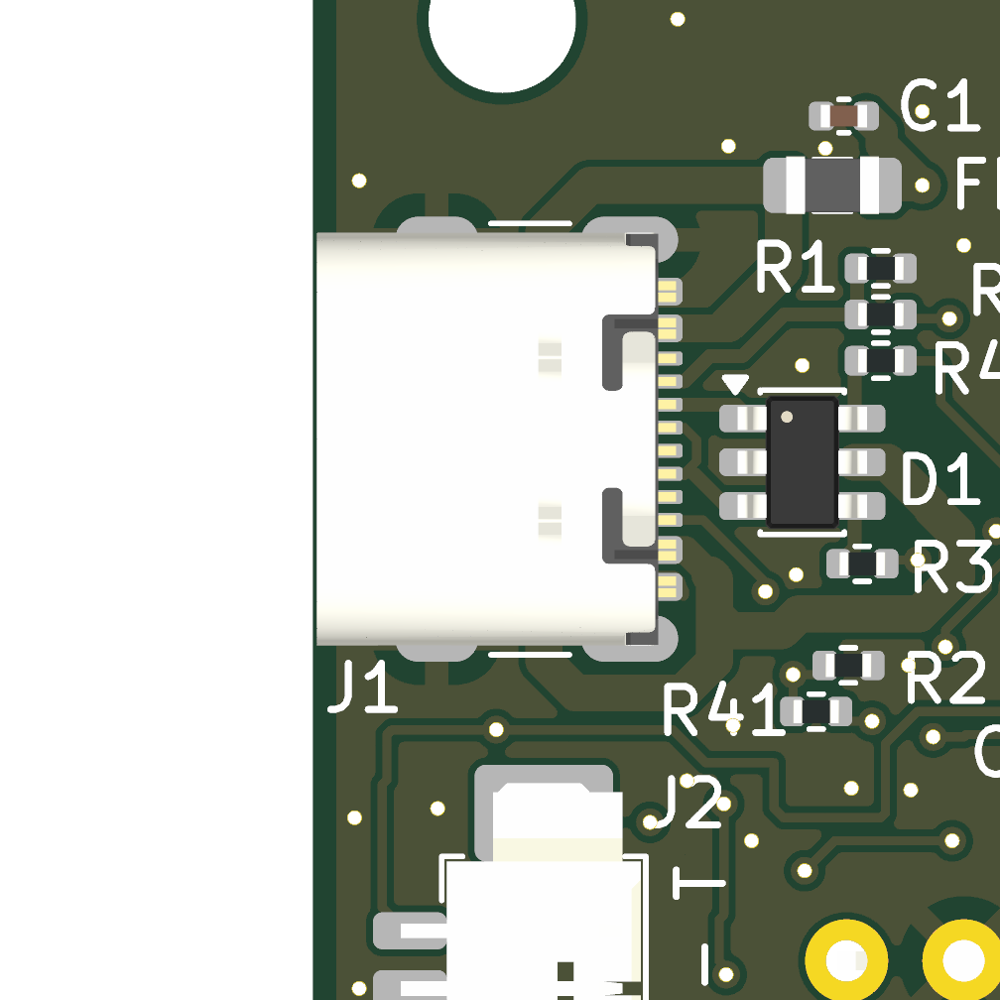

# Exporting

## THT fit

`pcbcraft export drawing board.kicad_pro` writes `board-drawing.pdf`: the board outline and drills at 1:1, front above back, on one A4 page. Print it and sit the THT parts on the holes as a first, preliminary check before you order any prototype.

`--side side` keeps the front. `--side back` keeps the back. `--full` adds color. `-o file.pdf` sets the path.

## JLCPCB order files

```text
pcbcraft export bom board.kicad_pro
pcbcraft export pos board.kicad_pro
pcbcraft export cpl board.kicad_pro --local corrections.yaml
```

`bom` is the JLCPCB bill (`Designator`, `Comment`, `Footprint`, `LCSC Part #`). A comment that contains a comma is replaced with the footprint name.

`pos` is the raw KiCad position file. `cpl` is the five-column file JLCPCB wants (`Designator`, `Mid X`, `Mid Y`, `Layer`, `Rotation`). It applies the rotation database, then `corrections.yaml`, which wins. Pass the project, or a fresh position file. A second run on an already corrected CPL mirrors the bottom again. `--dry-run` prints the moves and writes nothing.

Defaults: `board-bom.csv`, `board-pos.csv`, `board-cpl.csv`.

### corrections.yaml

`x` and `y` are millimetres in the position-file axes: X to the right, Y up. They shift the part center and stay in those axes when the part turns. `rotation` is whole degrees, added after the bottom side is mirrored. Positive is counter-clockwise. An omitted field is zero.

Give a `ref` or a `footprint`. A `ref` is an exact designator and wins. A footprint key matches that name, or that name followed by `-` or `_`: `SOT-23` matches `SOT-23-3`. `SOT-223` needs its own key.

```yaml
transformations:
  - ref: [Q1, Q2]
    rotation: -180
  - ref: J2
    x: -1.09
  - footprint: USB
    x: 1.24
```

In the JLCPCB assembly preview, before the board goes into the cart, the 2D view can measure a distance. Put that distance, in millimetres, into `x` or `y`.

## 2D view

`pcbcraft export 2d board.kicad_pro --symbol J1` writes a square PNG framed on that footprint. The footprint chooses the face. `--around-space` defaults to `5mm`. Without `--symbol`, `--side front` or `--side back` renders the whole face (default `front`, 1024 px).


