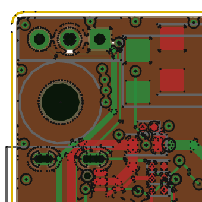

# Geometry

Coordinates are millimetres in the board file. Y grows downward, so `up` in a report is the decreasing-Y direction.

### Checking for free space at given coordinates

`pcbcraft geometry is-occupied --x 12.5 --y 8` says whether that point sits inside a blocking shape. `occupied` is true or false. `free.left`, `right`, `up`, and `down` are the millimetres to the next blocker, or to the edge of the square when `limitedByWindow` is true. Each hit names the `layer`, `source`, `ref`, `pad`, and `net`. The square side defaults to 10 mm (`--size`). The reply also includes the shapes inside that square. `--layer F.Cu` counts only those layers. The board edge and drills always count. Omit `--layer` to count every layer: copper when checking a track, every layer when checking whether a part fits.

### Finding a symbol

`pcbcraft geometry find-symbol J1` returns that footprint only. `window` is `xMin`, `xMax`, `yMin`, `yMax`. Under each layer, a shape has `source`, `ref`, `pad`, `net`, `width`, the occupied outline, and its clearance.

### Dumping the whole board

`pcbcraft geometry dump` prints blocking outlines for the whole board. A window such as `10-30x0-20` limits it. `--format png` draws the same view. The picture adds 1 mm of margin around the window.


### PNG export

This is how `pcbcraft` sees your board. In case geometry would incorrectly report `is-occupied` you can all the time make an export and inspect, especially before creating an issue on this project.

```text
pcbcraft geometry dump 22-37x24.3-39.3 board.kicad_pro --format png --output corner.png
```

That window is the top-left 15 mm of the outline: x from 22 to 37, y from 24.3 to 39.3.


