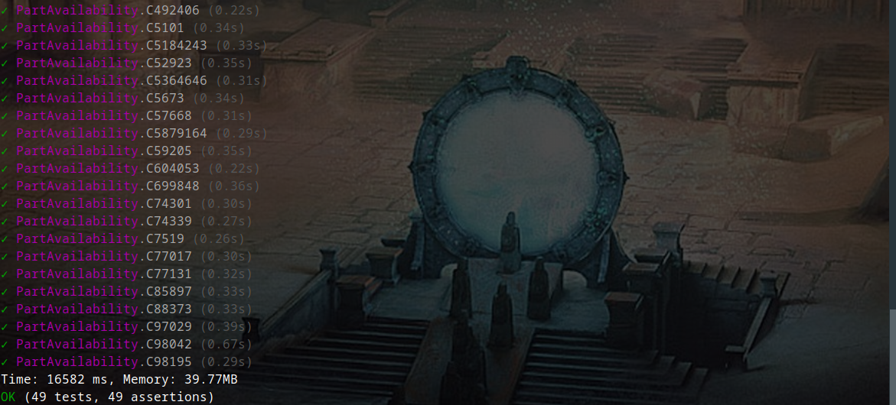

# Tests

`pcbcraft tests run` runs every JSON file under `tests/pcbcraft/`. `pcbcraft tests run checks` uses another directory. `pcbcraft tests run --name erc-test` runs one file: the path inside that directory, without `.json`. A nested file `electrical/power.json` is named `electrical/power`. Exit code 1 is a failed check. Exit code 2 is a schema or setup error.



`pcbcraft tests list` prints the files, then the types this program can run.

## Create

`pcbcraft tests init defaults` writes `erc-test.json`, `drc-test.json`, and `availability-test.json` when they are missing. The availability file sets `defaultMinimum` to 10. Omitting that field later means 100. One `.kicad_pro` in the current directory is written into `spec.project` as a path relative to the JSON file. Zero or several projects leave `project.kicad_pro` for you to set.

`pcbcraft tests init type ResistorPower power` writes one skeleton. The type and a file name, without an extension, are both required. `tests init defaults` creates only the three files above. Any other type starts from `tests init type`.

## Types

- [`ERCValidator`](tests/ERCValidator.md) — KiCad ERC.
- [`DRCValidator`](tests/DRCValidator.md) — KiCad DRC.
- [`JLCPCBDFM`](tests/JLCPCBDFM.md) — JLCPCB process limits.
- [`Attributes`](tests/Attributes.md) — mounting holes and fiducials stay out of the BOM, the position file, and the catalogs.
- [`PartAvailability`](tests/PartAvailability.md) — stock below `defaultMinimum` fails. `part` maps a catalog number to its own minimum.
- [`CatalogValue`](tests/CatalogValue.md) — schematic R, C, and L values against the LCSC card, inside the catalog tolerance.
- [`ResistorPower`](tests/ResistorPower.md) — a resistor between two declared rails against its power rating. `powerHeadroom` defaults to 2.
- [`VoltageRating`](tests/VoltageRating.md) — a capacitor, resistor, or inductor between two rails against its voltage rating. `voltageHeadroom` defaults to 2.
- [`Divider`](tests/Divider.md) — the output of two resistors between two rails. `expect` maps the output net to a voltage window.
- [`TimeConstant`](tests/TimeConstant.md) — τ of one resistor and one capacitor on the same two nets. `expect` uses times such as `1ms`.
- [`ParallelPassives`](tests/ParallelPassives.md) — the equivalent of resistors that share both nets.
- [`SeriesPassives`](tests/SeriesPassives.md) — the equivalent of two resistors or two capacitors whose middle net has only those two pins.

Run `pcbcraft components sync` before the catalog and electrical checks. A rail is an object with string `min` and `max`, both required (`"3.3V"`). A bare number is a schema error.

## Edit

Each file is one check. Change `spec`. Paths inside it are relative to the JSON file.

```json
{
  "type": "ResistorPower",
  "spec": {
    "project": "../../board.kicad_pro",
    "rails": {
      "+3V3": { "min": "3.0V", "max": "3.6V" },
      "GND": { "min": "0V", "max": "0V" }
    }
  }
}
```

`pcbcraft.yaml` in the current directory names lines that stay in the report and do not fail the run. The id is the type, a dot, and the line, for example `VoltageRating.C21`.

```yaml
tests:
  skipped:
    - VoltageRating.C21
```
